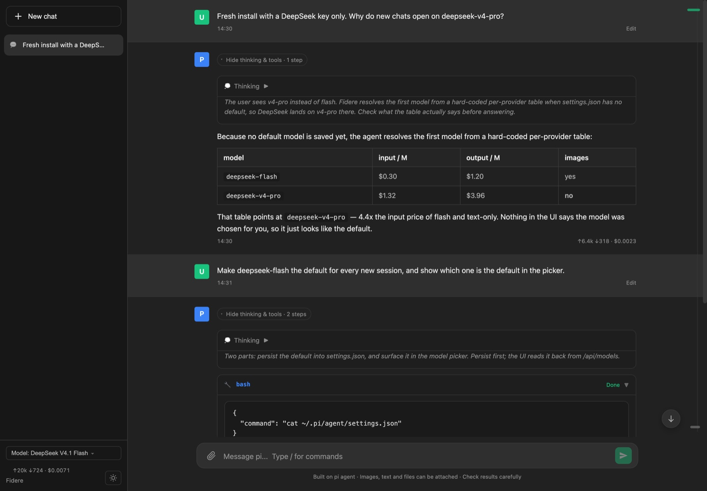

# Fidere

[](https://github.com/sean-cc/fidere/actions/workflows/ci.yml)
[](LICENSE)
[](package.json)

**English** | [简体中文](README.zh-CN.md) | [繁體中文](README.zh-TW.md) | [繁體中文（香港）](README.zh-HK.md) | [日本語](README.ja.md) | [한국어](README.ko.md) | [Русский](README.ru.md)

**An always-on assistant that works through its schedule while you're away — and stays accountable.**

Fidere is an assistant that stays on. You talk to it in the browser, ask it questions, drop ideas on it so they don't get lost; and when you're not around, it works through its schedule on its own — finishing without supervision, telling you the result, and stopping itself when a task runs over budget.

Fidere is Latin for **"to trust"**. Trust doesn't come from a smarter model. It comes from three plain things: **what it did can be checked, what it broke can be undone, and what it spent is on the books**.



> **New here?** Jump to [Quick start](#quick-start) to get from clone to a running assistant in about five minutes.

## What makes it different

### Small enough to read yourself

One dependency: the [pi coding agent](https://github.com/earendil-works/pi), which Fidere uses as a library — you don't install the `pi` CLI yourself. No frontend framework, no bundler, no CDN, about 8,300 lines of plain JS/CSS. No database, no message queue, no second service — `node scripts/start.mjs` is the whole run path. A workflow isn't a new language to learn; it's a few files in a directory you own.

### You don't pay for the same history twice

Most automation assistants are one session that never ends, and every turn resends the entire history to the model — so they get slower and more expensive the longer they run. Fidere does the opposite:

- **One session per task, thrown away when it finishes.** Tasks hand off a few hundred words of summary, not a whole transcript.
- **Steps that don't need judgement never reach the model.** Fetching, converting, verifying and notifying are scripts: 0 tokens.
- **Cheap models decide, expensive models do.** Routing, summarising and formatting run on a light model; only hard work gets upgraded.
- **Every task has a budget ceiling.** Go over it and the task stops, with what it reached and what it spent written to the ledger.

### "Done" is not something the model gets to say

Every task has an executable check; a non-zero exit code means it isn't done. Failures escalate in three steps: retry once on the same model → retry once on a stronger one → notify you and stop. It will not quietly grind until morning. A rerun can't duplicate a side effect (two notifications, two orders). Each task's session, commands, cost and result are all kept, so a bad run can be replayed instead of guessed at.

### Costs come from the real endpoint

Every reply carries its token usage and the vendor's own price for the endpoint that was actually called — DeepSeek's peak/off-peak rates, OpenRouter's per-token price, Zhipu, Moonshot, Aliyun and Anthropic's published pages — not a static rate card. Proxies and your own gateways are priced from the cost you configured for them. [How each endpoint is priced →](docs/pricing.md)

### It never swaps in an expensive model behind your back

New sessions start on a model you can see and change. If a reopened session had to switch models, that is announced above the transcript — the substitute can be several times more expensive, and that is not something to leave in a log file.

## Features

### Conversation: say whatever is on your mind

- **Continuous sessions** — keep talking; when context fills up it is summarised automatically instead of the agent forgetting where it was.
- **Notes you can open** — ideas, conclusions and to-dos are written to Markdown you can edit and search, not a black box.
- **Live streaming** — thinking and tool calls stream in live, fold when a reply finishes, and reopen per reply.
- **Timeline jump-back** — the timeline on the right jumps to an earlier prompt in one click; reading history doesn't pull you to the bottom.
- **Branching edits and recovery** — edit an earlier message and resend it on a new branch; copy replies, retry a rejected prompt, recover after a dropped stream.
- **Session and model management** — manage sessions, switch models, set the model new sessions start on, attach images and files.
- **Seven interface languages** — English, 简体中文, 繁體中文 (台灣 / 香港), 日本語, 한국어 and Русский.
- **Command palette** — one `/` palette for commands, models, skills and prompt templates ([shortcuts](#keyboard-shortcuts)).
- **Keep a Mac awake** — optional `caffeinate` assertion during long tasks.

### Tasks: handled while you're away

- **Schedules** — every N minutes, daily at a time, or on weekdays only.
- **Hard budget** — it stops rather than burning quietly.
- **Executable check** — the model saying "done" is a hint, not a conclusion.
- **Escalation and notification** — same model → stronger model → tell you and stop.
- **One run per scheduled moment** — plus a stable `FIDERE_RUN_KEY` the task can use to dedupe its own side effects.
- **Ledger and daily receipt** — what ran, what passed, what it cost.
- **Catch-up runs** — missed tasks are caught up after a reboot or a sleep, and the receipt says how late they were.

### Workflows: one page of instructions and a few scripts

No flowcharts, no new syntax, no orchestration engine. A workflow is a directory:

```text
workflows/finance-daily/
├── SKILL.md       ← instructions for the model, in prose
├── fetch.mjs      ← the deterministic part as a script: 0 tokens
└── verify.mjs     ← the check; exit 0 means done
```

A small frontmatter block at the top of `SKILL.md` is read by Fidere's scheduler; the body is read by the model:

```markdown
---
name: finance-daily
description: Summarise the financial news every morning as a short briefing.
schedule: daily 08:00
budget: ¥0.4
verify: node verify.mjs
notify: echo "$FIDERE_TASK ok=$FIDERE_TASK_OK" >> notify.log   # any shell command
tools: read,write,bash
---

# Daily financial briefing

1. Run `node fetch.mjs` first (don't write your own curl). Output: `out/raw.json`
2. Read `out/raw.json` and pick the 5 items most likely to move the index.
   Skip small single-company stories.
3. Write `out/digest.md`: two sentences per item, then a "what to watch today" note.
4. Run `node verify.mjs` to check your own work.

Never invent numbers. If it isn't in `raw.json`, it doesn't go in the file.
```

Three layers, one job each: **frontmatter for the code** (when, how much, how to verify, who to notify), **the body for the model** (how, what matters, what not to do), **the scripts for the machine** (the deterministic work). Domain content lives entirely in your own directory — Fidere assumes nothing about it.

The format is standard [Agent Skills](https://agentskills.io/specification), so a skill you already have can be dropped into `workflows/` and put on a schedule without being rewritten.

### The safety boundary for unattended work

When you're chatting you see a mistake as it happens; when nobody is watching, a mistake runs all night. So this isn't solved with a prompt asking the model to behave — it's solved with hard boundaries:

- **Permission tiers:** read-only / write only to a designated directory / run any command. The first two are the default; the third has to be turned on explicitly
- **Dangerous actions blocked in the tool layer:** deletion, force-push, uploads to external hosts and edits to credential files are refused and logged, not left to the model's judgement
- **A locked working directory:** a task works inside its own throwaway directory and is read-only outside it
- **Everything on record:** sessions, commands, cost and results are all persisted, so a run can be replayed

Fidere listens on `127.0.0.1`, is single-user, and accepts one access token. It is meant to be run by you — or by each person for themselves — not as a multi-tenant platform.

## Quick start

### Requirements

- Node.js **22.19+**
- An API key from a supported provider (Anthropic, OpenAI, Google, DeepSeek, OpenRouter, Moonshot, MiniMax, xAI, Groq, Mistral, and others)
- macOS, Linux or Windows. Only two things are macOS-specific: the optional sleep assertion (`npm run start:awake`) and `caffeinate` during long tasks. Everything else runs anywhere Node runs.

### 1. Clone and install

```bash
git clone https://github.com/sean-cc/fidere.git
cd fidere
npm install --ignore-scripts
npm run setup
```

`--ignore-scripts` skips npm lifecycle scripts, so nothing is executed at install time — Fidere doesn't need them. `npm run setup` asks you to choose a provider and enter its API key, and saves it to `~/.pi/agent/auth.json`. **You do not need to install the pi CLI**: it comes in as a normal dependency.

### 2. Start the server

```bash
npm start
```

### 3. Open and sign in

Open <http://localhost:3000> and paste the access token printed on startup. The token is also stored in `~/.pi/agent/fidere-token` (mode `0600`). The session cookie lasts 30 days.

### 4. Choose a model

Pick one from the model selector in the lower-left corner. If you don't, Fidere uses the saved default, then its own recommendation (see [FAQ](#faq)), then pi's per-provider fallback.

That's it — you can chat now, or write your first workflow under `workflows/`.

## Installation and configuration

The quick start above covers the recommended path. The rest is optional.

### Update checks

On each start `npm start` asks npm whether a newer pi is published. In an interactive terminal it asks whether to update; choosing yes installs it before starting the server. In a non-interactive environment it only prints the available version and starts normally. Set `FIDERE_SDK_UPDATE=off` to skip the check, or `auto` to update without asking.

### Use an environment variable instead of `npm run setup`

```bash
export ANTHROPIC_API_KEY=sk-ant-...
npm start
```

`OPENAI_API_KEY`, `GEMINI_API_KEY`, `DEEPSEEK_API_KEY` and the other provider environment variables work too. No pi CLI is required.

### Port and host

```bash
PORT=8080 npm start          # default 3000
HOST=0.0.0.0 npm start       # trusted networks only, see below
```

### Access control

Every API route needs an access token: it is read from `FIDERE_TOKEN`, or generated on first start into `~/.pi/agent/fidere-token`. Sign in by opening `/#token=<token>` or pasting it into the login overlay — the fragment never reaches the server or the proxy log. State-changing requests also need a double-submit CSRF token, which the UI sends automatically. [All access-control options →](docs/access-control.md)

The server listens on `127.0.0.1` by default. Do not expose it directly to the internet; use a reverse proxy with TLS or a private tunnel.

## Keyboard shortcuts

| Shortcut | Action |
|----------|--------|
| `Enter` | Send the message |
| `Shift+Enter` | Insert a new line in the composer |
| `/` | Open the command palette (commands, models, skills, prompt templates) |
| `↑` / `↓` | Move through palette results |
| `Tab` / `Enter` | Accept the selected palette item |
| `Esc` | Close the command palette or the resume-session dialog |
| `↑` / `↓`, `Home` / `End` | Jump between earlier prompts when the timeline on the right has focus |

## FAQ

- **Where do the prices come from?** Each model is priced by the endpoint it was actually called through, in the vendor's own currency: DeepSeek's official peak/off-peak rates, OpenRouter's per-token price, Zhipu's CNY pages, and the published pages/APIs for Anthropic, Moonshot, Aliyun and Hugging Face. Other endpoints use the `cost` you configured in `models.json`, with pi's bundled price as the last fallback. Full rules, currency overrides and the cache: [docs/pricing.md](docs/pricing.md).
- **No models?** Run `npm run setup` or set a provider environment variable, then restart the server.
- **Which model do new sessions start on?** `defaultProvider`/`defaultModel` from `~/.pi/agent/settings.json` first, then Fidere's own recommendation table (currently DeepSeek → `deepseek-flash`), then pi's built-in per-provider table. `npm run setup` writes the recommended model into settings, and **set default** on any row of the model picker changes it later. That override exists because pi's table starts DeepSeek on `deepseek-v4-pro` — 4.4x the input price of `deepseek-flash` and text-only — which is a costly surprise on a fresh install.
- **Does closing the lid stop tasks?** The server can hold a `caffeinate` assertion during active tasks, but closing the lid still sleeps unless the Mac is in clamshell mode. For real 24/7 work, use an always-on machine.
- **Where are keys stored?** `~/.pi/agent/auth.json`. API keys are never written to this repository.

## Development

```bash
npm test          # unit tests: prices, markdown, default models, SDK check, daemon
npm run smoke     # headless Chrome UI smoke test (needs Chrome/Chromium)
npm run dev       # start with node --watch
npm run daemon    # run the scheduler on its own (--list, --run <name>, --once)
```

Architecture, API endpoints, localization and pi upgrade notes live in [DEVELOPMENT.md](DEVELOPMENT.md).

### Contributing

Contributions are welcome. A few things that make a PR easy to merge:

1. Open an issue first for anything bigger than a bug fix, so the approach can be agreed on before you write it.
2. Keep it plain: no frontend framework, no bundler, no new runtime dependency unless there's no way around it.
3. Run `npm test` before pushing; `npm run smoke` if you touched the UI.
4. Say in the PR what you changed and how you verified it — a screenshot or a test name is enough.

UI strings go in `public/i18n.js`, and they need all seven locales (English, 简体中文, 繁體中文 台灣/香港, 日本語, 한국어, Русский) or the smoke test will fail.

## License

MIT. See [LICENSE](LICENSE).
