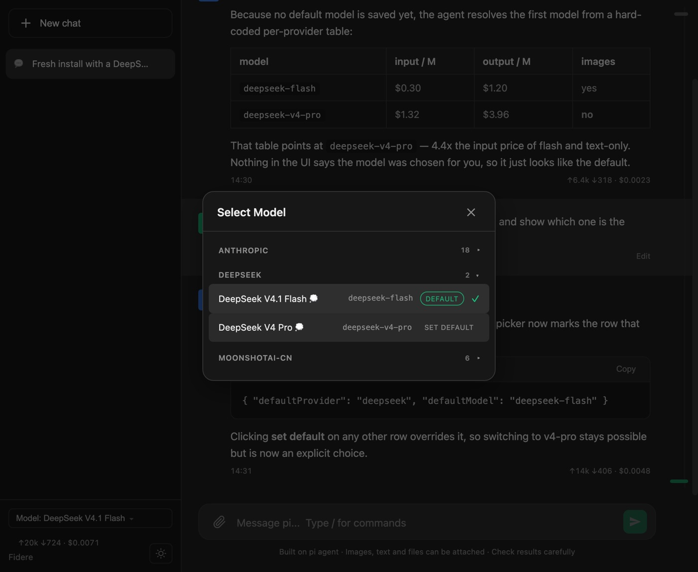

# Fidere

[](https://github.com/sean-cc/fidere/actions/workflows/ci.yml)

[English](README.md) | [简体中文](README.zh-CN.md) | [繁體中文](README.zh-TW.md) | **繁體中文（香港）** | [日本語](README.ja.md) | [한국어](README.ko.md) | [Русский](README.ru.md)


Fidere 是一個在瀏覽器裡執行的小型代理工作區。它以 [pi coding agent](https://github.com/earendil-works/pi/tree/main/packages/coding-agent) 的 SDK 為基礎打造，因此代理能讀寫檔案、執行指令，並即時串流它的思考與工具呼叫——同時不必把框架、打包工具或第二個服務拖到你的機器上。


- **刻意保持精簡** —— 只依賴一個套件（pi SDK）；前端零框架、無打包工具、不引 CDN。約 8,300 行原生 JS/CSS，`node scripts/start.mjs` 就是全部的執行路徑。
- **串流工作過程，不只看結論** —— 思考與工具呼叫即時出現在對話裡，回覆結束後自動摺疊，單則可再展開。
- **介面會說你的語言** —— 內建英文、简体中文、繁體中文（台灣／香港）、日本語、한국어、Русский 七種介面語言，點側邊欄的地球按鈕切換。
- **看得到花多少錢** —— 每則回覆都帶 token 用量，並依實際呼叫的端點取供應商官方價，不是一張靜態價目表。
- **不會背著你使用昂貴模型** —— 新工作階段從你看得見、改得動的模型開始；重開舊工作階段時模型被悄悄換掉，會在對話上方明確提示。



## 主要功能

- 在瀏覽器裡和代理對話，即時顯示思考過程與工具呼叫
- 每則回覆可單獨摺疊／展開思考過程與工具呼叫；回覆結束後自動摺疊，只看問答正文
- 右側對話時間軸：點一下就能回到之前的某次輸入
- 看歷史時頁面不會被新輸出拉走；想繼續看最新內容時再回到最新位置
- 管理工作階段、切換模型、上載圖片與檔案
- 指定新工作階段使用的模型（模型面板裡的 `set default`），重開舊工作階段時若模型被替換會在對話上方提示
- 查看每則回覆的時間、token 用量與費用（供應商官方價，含人民幣估算）
- 編輯之前送出的訊息並在新分支上重新送出；複製回覆、重試被拒絕的請求；串流中斷後自動恢復
- macOS 長任務執行期間可選擇阻止閒置休眠
- 切換介面語言：English / 简体中文 / 繁體中文（台灣）/ 繁體中文（香港）/ 日本語 / 한국어 / Русский（側邊欄地球按鈕）

## 快捷鍵

| 快捷鍵 | 作用 |
|--------|------|
| `Enter` | 送出訊息 |
| `Shift+Enter` | 在輸入框內換行 |
| `/` | 開啟指令面板（指令、模型、技能、提示詞範本） |
| `↑` / `↓` | 在指令面板結果中上下移動 |
| `Tab` / `Enter` | 選取目前的指令面板項目 |
| `Esc` | 關閉指令面板或恢復工作階段彈窗 |
| `↑` / `↓`、`Home` / `End` | 右側對話時間軸取得焦點時，在之前的輸入之間跳轉 |

## 環境需求

- Node.js **22.19 以上**
- 一個支援的供應商 API Key（Anthropic、OpenAI、Google、DeepSeek、OpenRouter、Moonshot、MiniMax、xAI、Groq、Mistral 等）

## 安裝與啟動

```bash
git clone https://github.com/sean-cc/fidere.git
cd fidere
npm install --ignore-scripts
npm run setup
npm start
```

接著開啟 <http://localhost:3000>，用啟動時列印的存取權杖登入（權杖也保存在 `~/.pi/agent/fidere-token`）。工作階段 Cookie 有效期為 30 天；完整參數見下方「存取權杖」一節。

每次啟動時，`npm start` 會檢查 npm 上是否有新的 pi SDK。在互動式終端機裡會詢問是否更新；選擇更新後會先安裝新版本，再啟動服務。非互動環境（背景／服務管理）只列印可更新版本，不會阻塞啟動。設定 `FIDERE_SDK_UPDATE=off` 可跳過檢查，`FIDERE_SDK_UPDATE=auto` 可自動更新。

`npm run setup` 會列出常用的供應商，選擇後輸入 API Key 即可。它只依賴安裝 Fidere 時一併裝好的依賴，**不需要另外安裝 pi CLI**。Key 會儲存到 `~/.pi/agent/auth.json`。

啟動後，在左下角的模型選擇器裡選一個模型。不選的話，會依序使用已儲存的預設模型、Fidere 自己的推薦（見下文），最後才是 SDK 的供應商預設表。

### 改用環境變數（可選）

不想用互動式 setup 的話，也可以直接設定環境變數：

```bash
export ANTHROPIC_API_KEY=sk-ant-...
npm start
```

`OPENAI_API_KEY`、`GEMINI_API_KEY`、`DEEPSEEK_API_KEY` 等環境變數同樣可用，不需要安裝 pi CLI。

修改連接埠：

```bash
PORT=8080 npm start
```

## 常見問題

- **價格從哪裡來？** Fidere 依模型實際呼叫的位址（baseUrl）定價：呼叫 `api.deepseek.com` 的模型使用 DeepSeek 官網的尖峰／離峰價（中文環境用中文頁／人民幣，其他環境用英文頁／美元；可用 `FIDERE_PRICE_CURRENCY=CNY|USD` 強制指定），呼叫 `openrouter.ai` 的模型使用 OpenRouter 官方按 token 價格，呼叫 `open.bigmodel.cn` 的模型使用智譜官方定價文件（人民幣）；呼叫 `api.anthropic.com`、`api.moonshot.cn`、`dashscope.aliyuncs.com`、`router.huggingface.co` 的模型也會使用各自官網價格頁／API；其他位址使用你在 `models.json` 中為該供應商設定的 `cost`（代理／第三方閘道依其自己的價格），SDK 內建價作為最後後備。價格保留供應商幣別（DeepSeek 中文環境、GLM、Moonshot、Aliyun 為人民幣；OpenRouter、Anthropic、HuggingFace 及非中文環境的 DeepSeek 為美元）；美元價格在提示裡以 7.2 的固定匯率估算人民幣（可用 `localStorage.setItem('fidere-usd-cny', '7.30')` 調整）。服務啟動時就開始檢查；檢查失敗的保留上一版快取，最新清單裡沒有的模型保留上次官方價，只有兩者都沒有時才用 SDK 價。快取位於 `~/.pi/agent/fidere-prices.json`；設定 `FIDERE_PRICES=off` 可關閉。狀態查看：`GET /api/prices`。
- **模型清單是空的？** 先執行 `npm run setup`，或設定一個供應商的環境變數，然後重新啟動服務。
- **新工作階段預設用哪個模型？** 依序看：`~/.pi/agent/settings.json` 裡的 `defaultProvider`／`defaultModel`，然後是 Fidere 自己的推薦表（目前只有 DeepSeek → `deepseek-flash`），最後才是 SDK 內建的供應商預設表。`npm run setup` 會把推薦模型寫進 settings；模型選擇面板裡每行右側的 **set default** 也能隨時改，選取行的 **default** 標記就是新工作階段會用的模型。之所以要多這一層：SDK 表把 DeepSeek 預設成 `deepseek-v4-pro`，輸入價是 `deepseek-flash` 的 4.4 倍且不支援圖片，新裝時很容易一上來就燒錢。
- **存取權杖：** 所有 API 都需要權杖。它來自 `FIDERE_TOKEN`，沒有就首次啟動時產生到 `~/.pi/agent/fidere-token`（權限 0600，啟動日誌會印出路徑）。首次登入用 `/#token=<權杖>` 或直接在登入頁貼上——fragment 不會送給伺服器，也不進反向代理日誌。工作階段 Cookie 為 `HttpOnly` + `SameSite=Strict`，有效期 30 天（`FIDERE_SESSION_MAX_AGE`，單位秒）。寫入操作還需帶上雙重提交的 CSRF 權杖，前端會自動送出；腳本可以用 `Authorization: Bearer <權杖>` 代替。`FIDERE_COOKIE_SECURE=auto|on|off` 控制 Cookie 的 `Secure` 標記（預設讀 `X-Forwarded-Proto`）。`FIDERE_AUTH=off` 可關閉認證，僅限別人碰不到的機器。
- **想從別的電腦存取？** 服務預設只監聽 `127.0.0.1`。不要直接暴露到互聯網；請放在帶 TLS 的反向代理或私有通道後面。`HOST=0.0.0.0` 只適合可信的區域網路。
- **Mac 合蓋後任務會停？** 服務在任務執行期間可以阻止閒置休眠，但合蓋休眠無法完全避免，除非使用合蓋模式。需要無人值守的長任務時，建議放在常開的機器上。
- **Key 存在哪裡？** `~/.pi/agent/auth.json`。API Key 不會寫進這個儲存庫。

## 開發

架構、測試、API 端點與 SDK 升級說明見 [DEVELOPMENT.md](DEVELOPMENT.md)。

## 授權

MIT，詳見 [LICENSE](LICENSE)。
